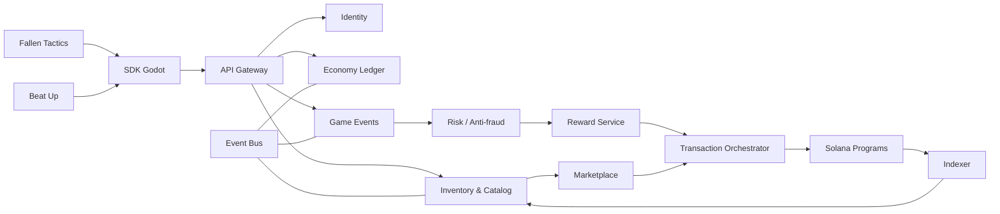

# Arquitetura do sistema

## Princípio

O servidor do jogo decide resultados; a blockchain decide propriedade e liquidação. O cliente Godot nunca possui chave de mint, segredo de API ou autoridade para premiar.

## Serviços

| Serviço | Responsabilidade | Dados principais |
|---|---|---|
| API Gateway | auth, rate limit, versão e roteamento | nenhuma fonte de verdade |
| Identity | Mutter ID, sessões, wallet links, consent | PII segregada |
| Catalog | games, collections, asset definitions, compatibilidade | PostgreSQL/versionado |
| Inventory | projeção unificada de entitlements + chain | PostgreSQL/cache |
| Game Events | ingestão idempotente de partidas | event store |
| Risk | regras, score, bloqueios e revisão | sinais antifraude |
| Economy Ledger | double-entry para moedas soft e obrigações | ledger imutável |
| Reward | budgets, vouchers e claims | grants/nonces |
| Marketplace | orders, quotes, status e histórico | orders/projeções |
| Transaction Orchestrator | simulação, assinatura controlada, envio e retry | tx intents |
| Indexer | confirmações/reorgs e projeções on-chain | cursor + eventos |

## Modelo de dados mínimo

- `player(id, status, region, created_at)`; PII em domínio separado.
- `wallet_link(player_id, chain, address, custody_type, verified_at)`.
- `game_account(player_id, game_id, external_id, state_version)`.
- `asset_definition(id, collection_id, schema_version, portability_policy)`.
- `inventory_item(id, owner_id, asset_definition_id, origin, chain_ref, status)`.
- `game_event(id, player_id, game_id, type, payload_hash, idempotency_key)`.
- `ledger_account`, `ledger_transaction`, `ledger_entry` com débito = crédito.
- `reward_grant(id, budget_id, event_id, amount, status, expires_at)`.
- `market_order(id, seller, asset, currency, price, status, chain_ref)`.
- `tx_intent(id, operation, signer_policy, state, signature, correlation_id)`.

## Consistência e eventos

- Escritas financeiras usam transação local + outbox.
- Consumidores são idempotentes; deduplicação por `event_id`.
- Estados on-chain: `CREATED → SUBMITTED → CONFIRMED → FINALIZED`; timeout não significa falha definitiva.
- Indexer reconcilia RPC primário e secundário. Divergência pausa liquidação, não gameplay.

## Interoperabilidade

Um asset possui `asset_definition_id`, `schema_version`, `traits` e `capabilities`. Cada jogo publica uma `portability_policy`:

- `native`: uso integral no jogo de origem;
- `mapped`: vira cosmético/equivalente explícito no outro jogo;
- `display_only`: aparece em perfil/troféu;
- `unsupported`: posse permanece, mas não há uso no jogo.

Exemplo: uma skin de carro Beat Up pode virar card back temático em Fallen Tactics. Stats do carro não são copiados para stats de unidade.
