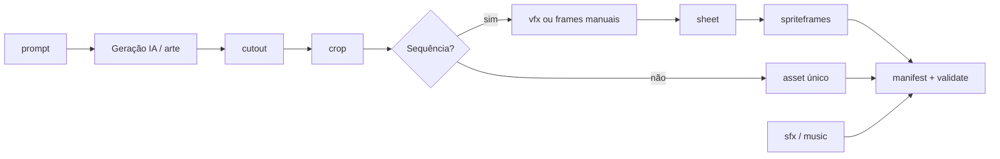

# Spec — MutterGames Creative Tools (TOOL-01)

**Versão:** 1.0.0  
**Data:** 2026-08-05  
**Implementação:** `scripts/mutter-creative.sh`  
**Guia rápido:** `scripts/creative-tools/README.md`

## 1. Objetivo

Acelerar a produção de assets reutilizáveis (imagem, VFX, áudio, briefs de IA e scaffolds Godot) com uma CLI única, previsível e auditável em qualquer jogo do monorepo.

## 2. Não-objetivos

- Substituir DCC (Aseprite, Photoshop, DAWs).
- Gerar arte final de marketing ou composição musical comercial.
- Assinar, criptografar ou publicar releases (isso é do Launcher/API).
- Rodar nativamente em PowerShell puro sem Bash.

## 3. Requisitos funcionais

| ID | Requisito | Aceite |
|---|---|---|
| CT-RF-01 | `doctor` reporta presença de `magick` e `ffmpeg` | Saída `[ok]` / `[--]` por binário |
| CT-RF-02 | `crop` normaliza imagem para `LxA` sem esticar o assunto | Arquivo de saída com dimensões pedidas |
| CT-RF-03 | `cutout` remove cor sólida (default `#ff00ff`) | PNG com alpha onde havia a cor-chave |
| CT-RF-04 | `sheet` monta PNGs ordenados em spritesheet | Tile `Nx` sem fundo |
| CT-RF-05 | `vfx` gera frames `forge\|nova\|collect` | `frame-00.png` … com ≥2 frames |
| CT-RF-06 | `sfx` gera WAV mono 48 kHz | Arquivo PCM s16le válido |
| CT-RF-07 | `music` gera loop ambient/tension/victory | Fade in/out + limiter |
| CT-RF-08 | `prompt` escreve brief Markdown padronizado | Categoria `asset\|vfx\|music` |
| CT-RF-09 | `spriteframes` gera `.tres` Godot 4 a partir de atlas `res://` | `SpriteFrames` com grade L×A |
| CT-RF-10 | `manifest` lista PNG/WAV/OGG/SVG em JSON | Campo `generator: mutter-creative` |
| CT-RF-11 | `validate` inspeciona imagens/áudio quando deps existem | Exit ≠0 se arquivo ilegível |
| CT-RF-12 | `scaffold` cria stubs `hud\|pickup\|vfx` em GDScript | Arquivo `.gd` com `class_name` |

## 4. Requisitos não funcionais

| ID | Meta |
|---|---|
| CT-RNF-01 | Falha rápida com mensagem `erro:` e código ≠0 |
| CT-RNF-02 | Não sobrescreve deps do sistema; só escreve paths pedidos |
| CT-RNF-03 | Comandos de imagem/áudio exigem a ferramenta correspondente (`need`) |
| CT-RNF-04 | Outputs intermediários de VFX (SVG temp) são removidos após raster |
| CT-RNF-05 | CLI idempotente o suficiente para reexecução (ffmpeg `-y`) |

## 5. Interface CLI

```text
scripts/mutter-creative.sh <comando> [args]
```

| Comando | Assinatura |
|---|---|
| `doctor` | — |
| `crop` | `<entrada> <saída> <LxA> [gravidade]` |
| `cutout` | `<entrada> <saída> [cor]` |
| `sheet` | `<pasta-frames> <saída> <colunas>` |
| `vfx` | `<forge\|nova\|collect> <pasta> [tamanho=256] [frames=12]` |
| `sfx` | `<forge\|collect\|error\|nova> <saída.wav> [segundos=0.6]` |
| `music` | `<ambient\|tension\|victory> <saída.wav> [segundos=24]` |
| `prompt` | `<asset\|vfx\|music> <arquivo.md> <texto>` |
| `spriteframes` | `<res://texture> <saída.tres> <L> <A> <cols> <rows> [fps=12]` |
| `manifest` | `<pasta-assets> <saída.json>` |
| `validate` | `<pasta-assets>` |
| `scaffold` | `<hud\|pickup\|vfx> <saída.gd>` |
| `help` | — |

## 6. Fluxo canônico de produção



## 7. Convenções de assets

| Regra | Detalhe |
|---|---|
| Temporários | `tmp/` na raiz do workspace ou do jogo |
| Finais | `assets/` do projeto consumidor |
| Frames | `frame-00.png`, `frame-01.png`, … |
| Chromakey | `#FF00FF` para cutout |
| Áudio procedural | ponto de partida; substituir por master final antes de release |
| Proveniência | guardar prompt/seed/versão do gerador junto ao asset quando procedural |
| Godot | texturas em `spriteframes` sempre como `res://...` |

## 8. Contrato do manifesto

```json
{
  "generator": "mutter-creative",
  "assets": [
    { "path": "vfx/forge-sheet.png", "extension": "png" }
  ]
}
```

Campos futuros (não implementados): `hash`, `license`, `source_prompt`, `generator_version`.

## 9. Integração com jogos e geradores

| Fonte | Uso esperado |
|---|---|
| Fallen Tactics | VFX de combate, sheets de unidade, SFX, briefs de cards/UI |
| Beat Up | Decals, VFX de impacto, stubs de HUD, validação de packs |
| Taskbar Planets | Pós-processar PNG do Seed Lab (`cutout`/`crop`/`manifest`) |
| OpenRouter Image (TOOL-09) | `generate` → `crop`/`cutout` → `manifest`/`validate` |

## 10. Critérios de aceite da ferramenta

1. `doctor` roda sem deps instaladas.  
2. Com ImageMagick+FFmpeg: pipeline `vfx → sheet → spriteframes → validate` completa sem erro.  
3. `spriteframes` abre no Godot 4.7 sem edição manual do `.tres`.  
4. README rápido e esta spec permanecem alinhados à lista de comandos do script.

## 11. Evolução prevista

| Item | Prioridade |
|---|---|
| Hash SHA-256 no `manifest` | P1 |
| Flag `--dry-run` | P2 |
| Preset de paleta por jogo (`--game fallen\|beatup\|planets`) | P2 |
| Job CI `validate` em PRs de `assets/` | P1 |
| Porta PowerShell (`mutter-creative.ps1`) | P2 |
