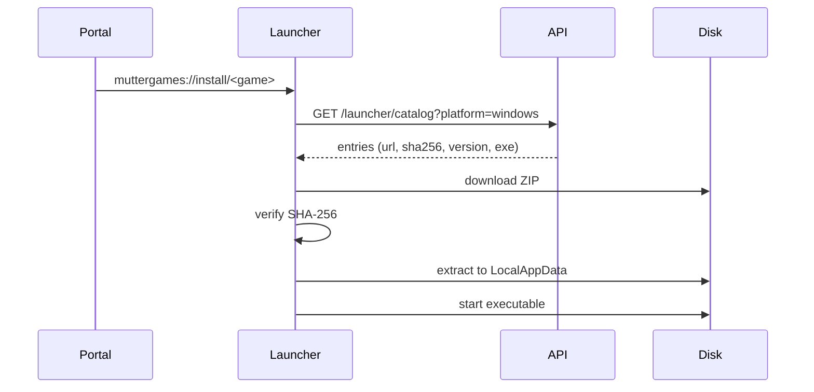

# Spec — MutterGames Launcher (TOOL-02)

**Versão:** 1.0.0  
**Data:** 2026-08-05  
**Implementação:** `apps/launcher/`  
**Guia:** `apps/launcher/README.md`

## 1. Objetivo

Permitir que jogadores Windows descubram, instalem, atualizem e abram jogos MutterGames a partir de um catálogo autenticado pela API, com verificação de integridade.

## 2. Não-objetivos

- Loja de mods ou UGC.
- Patch binário delta (MVP usa ZIP completo).
- Suporte macOS/Linux no MVP.
- Distribuição de builds unsigned sem hash.

## 3. Requisitos funcionais

| ID | Requisito | Aceite |
|---|---|---|
| LN-RF-01 | Consultar catálogo por plataforma | `GET /api/v1/launcher/catalog?platform=windows` |
| LN-RF-02 | Instalar release ZIP | Extração em `%LOCALAPPDATA%\MutterGames\Games\<game>` |
| LN-RF-03 | Verificar SHA-256 | Instalação aborta se hash divergir |
| LN-RF-04 | Atualizar quando versão mudar | Re-download e troca atômica da pasta/versão |
| LN-RF-05 | Abrir executável configurado | Path relativo declarado no catálogo |
| LN-RF-06 | Registrar protocolo `muttergames://` | Deep link do portal inicia fluxo de install |
| LN-RF-07 | Ocultar release incompleta | Sem URL/SHA/executable → não instalável |

## 4. Requisitos não funcionais

| ID | Meta |
|---|---|
| LN-RNF-01 | Build self-contained single-file .NET 8 `win-x64` |
| LN-RNF-02 | Não exigir admin para install no LocalAppData |
| LN-RNF-03 | Falhas de rede/hash com mensagem acionável |
| LN-RNF-04 | Telemetria mínima: eventos de install/update/launch sem PII |

## 5. Contrato de release (API / env)

Variáveis típicas na API (por jogo):

| Campo | Descrição |
|---|---|
| `*_DOWNLOAD_URL` | HTTPS do ZIP |
| `*_SHA256` | Hash lowercase do ZIP |
| `*_EXECUTABLE_PATH` | Caminho relativo do `.exe` dentro do ZIP |
| `LAUNCHER_DOWNLOAD_URL` | URL do próprio launcher publicado |

Publicação Godot → ZIP → hash:

```powershell
(Get-FileHash .\FallenTactics.zip -Algorithm SHA256).Hash.ToLower()
```

Build do launcher:

```powershell
pnpm build:launcher
# ou
dotnet publish apps/launcher/MutterGames.Launcher.csproj -c Release -r win-x64 --self-contained true -p:PublishSingleFile=true -o outputs/launcher/win-x64
```

## 6. Fluxo



## 7. Critérios de aceite

1. Com catálogo completo, install → verify → launch funciona offline na segunda abertura (binário já local).  
2. Hash incorreto não deixa binário “instalado” utilizável.  
3. Entrada sem `DOWNLOAD_URL`/`SHA256`/`EXECUTABLE_PATH` não aparece como instalável.  
4. Protocolo `muttergames://` registrado na primeira execução.

## 8. Segurança

- Somente HTTPS para downloads.
- SHA-256 obrigatório no MVP; assinatura Authenticode é P1.
- Launcher não embute secrets de API privilegiada.
- Não executar conteúdo fora do path de install gerenciado.

## 9. Evolução

| Item | Prioridade |
|---|---|
| Code signing Authenticode | P1 |
| Diff/patch updates | P2 |
| Catálogo autenticado por Mutter ID | P1 |
| macOS/Linux | P2 |
| Rollback de versão | P2 |
