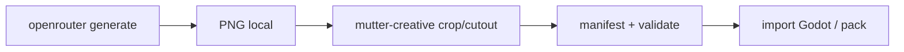

# Spec — OpenRouter Image Adapter (TOOL-09)

**Versão:** 1.0.0  
**Data:** 2026-08-05  
**Implementação:** `scripts/openrouter-image.sh`  
**Guia:** `scripts/creative-tools/openrouter-image.md`

## 1. Objetivo

Gerar imagens de assets via API OpenRouter (`/api/v1/images`), gravar PNGs/WebP locais e alimentar o pipeline Creative Tools (`crop` / `cutout` / `manifest` / `validate`).

## 2. Não-objetivos

- Persistir `OPENROUTER_API_KEY` em `.env` versionado ou logs.
- Garantir bit-stability universal (depende do modelo/seed suportado).
- Substituir Seed Lab para planetas determinísticos do Taskbar Planets.

## 3. Requisitos funcionais

| ID | Requisito | Aceite |
|---|---|---|
| OR-RF-01 | `models` lista modelos de imagem | JSON em stdout ou arquivo |
| OR-RF-02 | `generate` exige `--model`, `--prompt`, `--out` | Exit ≠0 se faltar |
| OR-RF-03 | Grava `prefixo-01.ext` … a partir de `b64_json` | Arquivos no disco |
| OR-RF-04 | Suporta size, aspect-ratio, quality, format, background, seed, n | Flags parseadas; modelo pode ignorar |
| OR-RF-05 | `--reference` aceita URL ou arquivo local | Local vira `data:` URL |
| OR-RF-06 | Transparência só com png/webp | Validação pré-request |
| OR-RF-07 | Exibe metadados de custo quando a API retornar | Sem imprimir a chave |

## 4. Segurança

| ID | Regra |
|---|---|
| OR-SEC-01 | Chave somente em variável de ambiente de sessão |
| OR-SEC-02 | Nunca logar `OPENROUTER_API_KEY` |
| OR-SEC-03 | Não versionar respostas com secrets embutidos |
| OR-SEC-04 | Preferir prompts sem PII / dados de jogadores reais |

## 5. Interface CLI

```text
scripts/openrouter-image.sh models [arquivo.json]
scripts/openrouter-image.sh generate --model <m> --prompt <t> --out <prefixo> [opts]
```

Deps: `curl`, `jq`, `base64`, Bash.

## 6. Fluxo com Creative Tools



## 7. Proveniência obrigatória no pack

Registrar junto ao asset (README ou sidecar JSON):

- modelo
- prompt
- seed (se houver)
- size / aspect / quality / background
- data e custo aproximado

## 8. Critérios de aceite

1. Sem chave → erro claro, nada escrito no repo.  
2. Com chave válida → `generate` cria arquivo e `validate` aceita o PNG.  
3. Guia e script listam as mesmas flags.  
4. Referência local inexistente falha antes do POST.

## 9. Evolução

| Item | Prioridade |
|---|---|
| Sidecar `.meta.json` automático por geração | P1 |
| Integração `mutter-creative prompt` → openrouter | P2 |
| Allowlist de modelos no monorepo | P1 |
| Dry-run de custo estimado | P2 |
