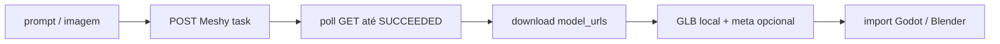

# Spec — Meshy Asset Adapter (TOOL-06)

**Versão:** 1.0.0  
**Data:** 2026-08-05  
**Implementação:** `scripts/meshy-asset.sh`  
**Guia:** `scripts/creative-tools/meshy-asset.md`

## 1. Objetivo

Gerar assets 3D via [Meshy API](https://docs.meshy.ai/en/api/quick-start) (Text-to-3D e Image-to-3D), gravar modelos locais (GLB/FBX/…) e sidecar de proveniência para importação em Godot / Blender / packs do monorepo.

## 2. Não-objetivos

- Commitar `MESHY_API` / `MESHY_API_KEY` em arquivos versionados ou logs.
- Substituir modelagem/retopologia/art direction finais.
- Expor a API Meshy via CORS ou proxy browser (a Meshy não suporta CORS).
- Microserviço Beat Up legado (`services/meshy/`) — este adaptador CLI é o caminho canônico.

## 3. Requisitos funcionais

| ID | Requisito | Aceite |
|---|---|---|
| MY-RF-01 | `balance` consulta créditos | JSON com `balance` |
| MY-RF-02 | `text-to-3d` exige `--prompt` e `--out` | Exit ≠0 se faltar |
| MY-RF-03 | `text-to-3d` faz preview → refine → download (default) | Arquivo `.glb` (ou `--format`) no disco |
| MY-RF-04 | `--preview-only` para após preview | Malha sem textura refinada |
| MY-RF-05 | `image-to-3d` aceita URL ou arquivo local | Local vira data URI |
| MY-RF-06 | Polling até `SUCCEEDED`/`FAILED` | Progresso em stderr |
| MY-RF-07 | `--no-wait` só cria a tarefa | Imprime `id` e sai |
| MY-RF-08 | `status` / `download` por `--kind text\|image` | Operam sobre task id |
| MY-RF-09 | `--meta` grava sidecar `.meta.json` | Sem incluir a API key |

## 4. Segurança

| ID | Regra |
|---|---|
| MY-SEC-01 | Chave em `MESHY_API` (ou `MESHY_API_KEY`) de sessão / `.env` gitignored |
| MY-SEC-02 | Nunca logar a chave |
| MY-SEC-03 | Não versionar respostas com secrets embutidos |
| MY-SEC-04 | Preferir prompts sem PII / dados de jogadores reais |

## 5. Interface CLI

```text
scripts/meshy-asset.sh balance
scripts/meshy-asset.sh text-to-3d --prompt <t> --out <prefixo> [opts]
scripts/meshy-asset.sh image-to-3d --image <URL|arquivo> --out <prefixo> [opts]
scripts/meshy-asset.sh status --kind <text|image> --id <task_id>
scripts/meshy-asset.sh download --kind <text|image> --id <task_id> --out <arquivo>
```

Deps: `curl`, `jq`, `base64`, Bash. Via Forge: `scripts/mutter-forge.sh meshy …`.

## 6. Fluxo



## 7. Proveniência

Com `--meta`, registrar junto ao asset:

- `generator: meshy-asset`
- task id(s), prompt / image_source
- `ai_model`, `model_type`, créditos consumidos
- timestamp ISO

Baixar antes do prazo de retenção (3 dias em planos não-Enterprise).

## 8. Critérios de aceite

1. Sem chave → erro claro, nada escrito no repo.  
2. Com chave válida → `text-to-3d` ou `image-to-3d` cria arquivo local.  
3. Guia e script listam as mesmas flags.  
4. Imagem local inexistente falha antes do POST.

## 9. Evolução

| Item | Prioridade |
|---|---|
| Remesh / Rigging / Animation na mesma CLI | P2 |
| Integração `mutter-forge 3d meshy` como alias | P1 (feito via grupo `meshy`) |
| Allowlist de prompts/modelos por jogo | P2 |
| Webhook em vez de polling | P3 |
