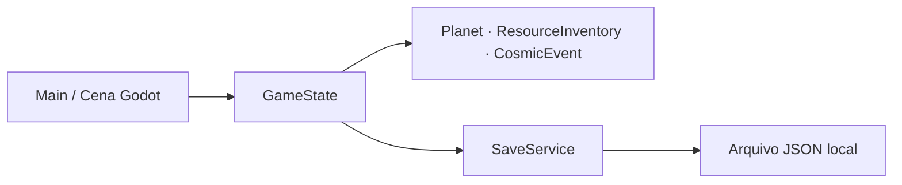

# Classes e padrões de projeto — implementação Godot

Este documento descreve o MVP implementado em `task-bar-planet-forger`. O núcleo é deliberadamente independente da cena/UI para que as regras possam ser testadas e evoluídas sem acoplamento ao Godot visual.

## Classes

| Classe/arquivo | Camada | Responsabilidade |
|---|---|---|
| `GameState` (`scripts/game_state.gd`) | Aplicação | Autoload que conduz o tick, os casos de uso, progresso offline e ciclo de vida do jogo. |
| `ResourceInventory` (`scripts/resource_inventory.gd`) | Domínio | Armazena recursos, capacidades, custos e impede saldos negativos. |
| `Planet` (`scripts/planet.gd`) | Domínio | Representa planeta, órbita, condições de habitabilidade e estágios de evolução. |
| `CosmicEvent` (`scripts/game_event.gd`) | Domínio | Representa evento e escolhas; também constrói o conjunto de eventos elegíveis do MVP. |
| `SaveService` (`scripts/save_service.gd`) | Infraestrutura | Salva/restaura JSON versionado e mantém um backup local. |
| `GameSettings` (`scripts/game_settings.gd`) | Configuração | Centraliza preferências persistidas de janela, acessibilidade, notificações e desempenho. |
| `TutorialState` (`scripts/tutorial_state.gd`) | Tutorial | Mantém o passo atual do tutorial não bloqueante. |
| `Main` (`scripts/main.gd`) | Apresentação | Controlador da cena: mostra estado, recebe ações e apresenta eventos. |

`main.tscn` contém somente composição visual e conexões de sinais. Não contém regras econômicas nem de simulação.

## Padrões adotados

| Padrão | Aplicação | Benefício |
|---|---|---|
| **Service Layer / Facade** | `GameState` oferece `create_asteroid`, `forge_planet`, `terraform`, `start_life`, `advance_civilization` e `prestige`. | A UI não altera entidades diretamente e os fluxos de jogo ficam centralizados. |
| **Observer** | Sinais `state_changed`, `notification_sent` e `event_started`. | A interface reage à simulação sem polling de regras ou referência inversa do domínio à UI. |
| **Repository simplificado** | `SaveService.save/load`. | Isole persistência do modelo e permite substituir JSON por outro meio no futuro. |
| **Value Object / Entidade de domínio** | `ResourceInventory`, `Planet` e `CosmicEvent`. | Regras e invariantes ficam próximas aos dados que protegem. |
| **State Machine explícita** | `Planet.stage_name()` deriva `Em formação → Habitável → Vida → Civilização`; `active_event` representa evento aberto/fechado. | Torna a progressão legível e evita estados visuais incoerentes. |
| **Command-like use cases** | Métodos públicos de `GameState` correspondem às ações do jogador. | Facilita adicionar histórico, telemetria, atalhos e testes por ação. |
| **DTO de persistência** | `serialize`, `deserialize` e `from_data`. | Mantém o formato salvo separado da representação em memória e suporta migração de schema. |
| **Adapter Boundary** | Acesso à janela fica em `GameSettings.apply_to_window`; integrações nativas futuras entram no mesmo limite. | Evita que APIs Windows se espalhem pelas regras do jogo. |

## Dependências permitidas

`Planet`, `ResourceInventory` e `CosmicEvent` não devem importar nós de UI, cena ou APIs de janela. Novos recursos nativos — bandeja, monitor, posição e notificações Windows — devem entrar como adaptadores chamados por `GameState` ou por uma camada de apresentação, nunca dentro das entidades de domínio.
