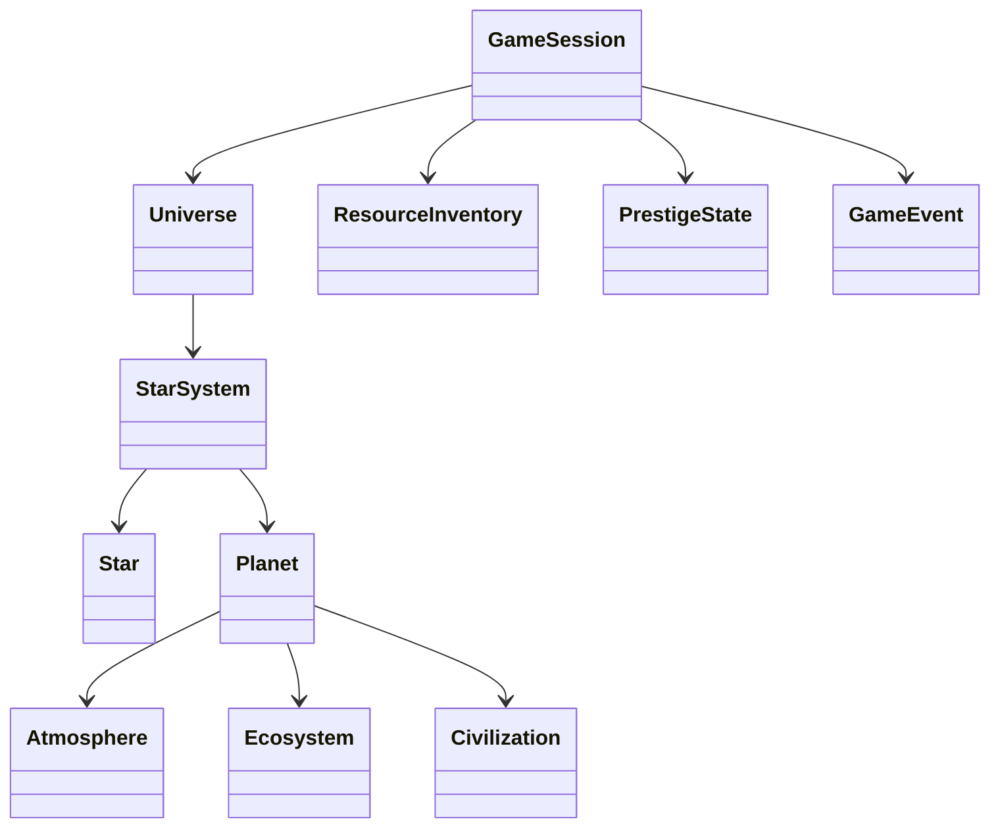

# Modelo de domínio

| Elemento | Responsabilidade e invariantes |
|---|---|
| GameSession | Coordena comandos, tempo e save; não contém regra visual. |
| Universe/StarSystem | Possui sistemas e órbitas; uma órbita não pode ter dois corpos principais. |
| Planet | Evolui de acordo com tipo e condições; não gera vida sem habitabilidade. |
| ResourceInventory | Mantém quantidades entre zero e capacidade. |
| GameEvent | Aplica efeitos por seed e estado; não repete categoria em recarga. |
| PrestigeState | Mantém Essência/upgrades entre reinicializações. |

Eventos de domínio: `PlanetCreated`, `LifeStarted`, `EventResolved`, `PrestigeExecuted` e `SaveRequested`.
