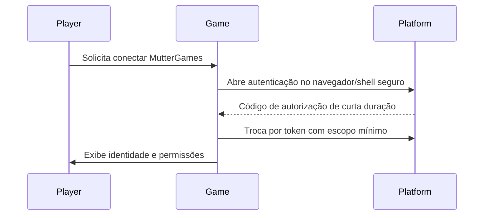

# Planejamento de conexão com MutterGames

## Princípios

1. O jogo funciona integralmente sem conexão ou wallet.
2. A conexão é iniciada pelo jogador no painel expandido, nunca no primeiro uso.
3. Nenhuma ação de gameplay, save ou prestígio depende de serviço externo.
4. O mínimo de dados é compartilhado e o consentimento pode ser revogado.

## Fluxo proposto (pós-MVP)

## Escopos candidatos

`profile.read` (nome/exibição), `catalog.read` (itens elegíveis) e `entitlements.read` (propriedade). Não solicitar `wallet.sign`, transferências ou escrita de inventário até haver caso de uso aprovado.

## Pendências

[PENDENTE] Definir OAuth/OIDC, PKCE, deep-link/loopback, expiração/renovação de token, endpoint oficial e contrato de erros da plataforma. Tokens ficam no armazenamento seguro do SO, nunca no arquivo de save.
