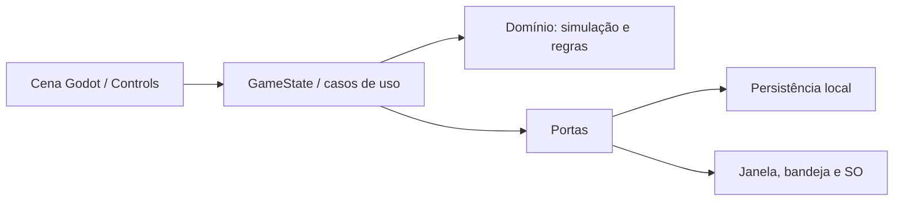

# Arquitetura técnica

> [DECIDIDO] Godot 4.7 + GDScript para o jogo, interface e janela desktop. APIs nativas do Windows que não sejam expostas pelo motor entram por adaptadores GDExtension ou plugins, sem acoplar o domínio a eles.

O domínio não conhece cenas Godot, GDExtension ou MutterGames. O game loop híbrido aplica ticks leves em primeiro plano e cálculo agregado quando inativo/offline. Eventos internos disparam autosave; persistência usa arquivo temporário, backup e checksum.

Critérios de escolha: UI e jogo 2D no mesmo motor, baixo atrito de prototipagem, suporte a exportação Windows e facilidade de testes de domínio.
