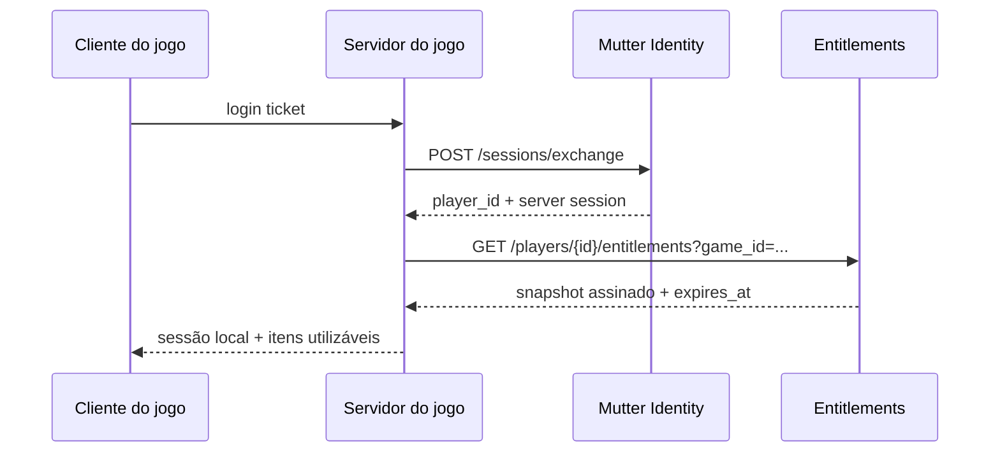
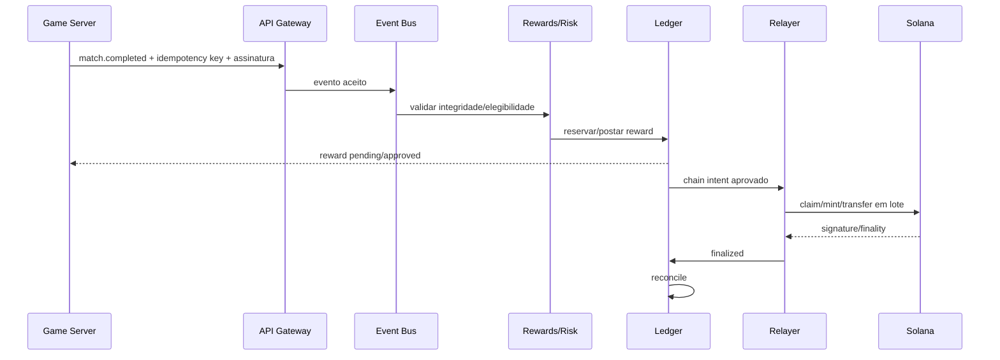
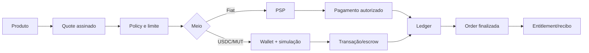

# MutterGames Ecosystem — Especificação de Implementação

**Versão:** 1.0  
**Data:** 4 de agosto de 2026  
**Status:** baseline para arquitetura, estimativas e criação do backlog  
**Documento relacionado:** `MutterGames-Blockchain-Whitepaper.md`

> Objetivo: especificar como servidores de jogos, plataforma MutterGames, programas Solana, lojas e páginas web se conectam com segurança. Este documento não autoriza lançamento financeiro; mainnet depende de testes, auditorias e validação jurídica.

## 1. Resultado esperado

O MVP permitirá que Fallen Tactics, Beat Up e um jogo-piloto usem a mesma identidade, consultem inventário, emitam eventos de gameplay, recebam entitlements e realizem compras elegíveis. Partidas continuam funcionando quando a blockchain está indisponível. Apenas o backend MutterGames concede valor; clientes nunca possuem credenciais de servidor ou autoridade de mint.

### 1.1 Princípios obrigatórios

- Servidor de jogo autoritativo para gameplay e resultados.
- Ledger interno de dupla entrada como sistema operacional da economia.
- Solana como propriedade e liquidação final, não banco de dados de gameplay.
- Todos os comandos mutáveis idempotentes, autenticados, auditáveis e versionados.
- Gameplay central funciona em modo degradado sem RPC.
- Wallet, token, NFT e marketplace são opcionais no onboarding.
- Nenhum segredo, private key ou server API key entra no cliente do jogo.
- Cada módulo on-chain possui caps, pause e autoridade multisig/timelock.

## 2. Arquitetura do sistema

```text
CLIENTES
  Jogos PC/Mobile/Console     Portal Web     Marketplace     Admin/Support
             │                    │                │                │
             └──────────── CDN / WAF / API Gateway / BFFs ─────────┘
                                      │
PLATAFORMA MUTTERGAMES                │
  Identity ─ Player Profile ─ Wallet Orchestrator ─ Policy/Risk
  Game Registry ─ Catalog ─ Inventory ─ Entitlements ─ Missions
  Economy/Ledger ─ Rewards ─ Marketplace ─ Orders ─ Notifications
       │             │              │              │
       └──── Event Bus / Outbox / Job Queue / Audit Log ────────────┐
                                                                   │
CHAIN SERVICES                                                     │
  Relayer/Signer ─ RPC Router ─ Solana Programs ─ Indexer ─ Reconciler
       │                          │                         │
       └────────────── Solana Devnet/Mainnet ──────────────┘

DATA
  PostgreSQL HA | Redis | Object Storage | Secrets/KMS | Warehouse/Lake
```

### 2.1 Zonas de confiança

| Zona | Confiança | Pode conceder valor? | Controles principais |
|---|---|---:|---|
| Cliente do jogo/browser | hostil | não | TLS, CSP, anti-tamper, tokens curtos |
| Servidor de jogo | parceiro controlado | solicita | workload identity, assinatura, allowlist |
| Economy/Ledger | alta | autoriza/reserva | dupla entrada, idempotência, policy |
| Relayer/Signer | mínima e isolada | executa intenção aprovada | KMS/MPC, egress allowlist, caps |
| Programas Solana | verificável | liquida | invariantes, PDAs, pause, auditoria |
| Indexer | derivada | não | múltiplas fontes, replay, checkpoints |

## 3. Componentes de servidor

### 3.1 API Gateway

Responsabilidades: TLS, roteamento, autenticação preliminar, rate limit, WAF, request size, correlation ID e versionamento. Não contém regra econômica. Meta inicial: 99,95% de disponibilidade e p95 abaixo de 80 ms de overhead.

### 3.2 Identity Service

Mantém `player_id`, credenciais, sessões, consentimentos e vínculos de carteira. Protocolos: OIDC/OAuth 2.1, passkeys/WebAuthn e challenge de assinatura. Tokens de usuário têm audiência, escopo e expiração de até 15 minutos; refresh tokens são rotativos. Recovery de conta aplica step-up e cooldown para transferências.

### 3.3 Game Registry

Registra `game_id`, ambientes, origens, versões do SDK, chaves públicas de workload, owners, scopes e política econômica. Alterações críticas exigem aprovação de duas pessoas. Um jogo suspenso continua permitindo leitura de inventário, mas não cria novos eventos econômicos.

### 3.4 Catalog Service

Fonte canônica de produtos, coleções, SKUs, preços lógicos, metadata hashes, compatibilidade e estados de publicação. Publicações usam workflow `DRAFT → REVIEW → APPROVED → PUBLISHED → RETIRED`. Nunca atualiza metadata de ativo sem versionamento e trilha.

### 3.5 Inventory e Entitlements

Inventory agrega ativos on-chain indexados e itens internos. Entitlement traduz um ativo em direito local por jogo. O cliente recebe uma visão assinada e com TTL; servidor de jogo valida assinatura ou consulta a API. Cache expirado pode manter cosmético já equipado, mas não autoriza venda/consumo.

### 3.6 Economy/Ledger

Serviço de maior criticidade. Mantém contas e lançamentos imutáveis em unidades atômicas. Uma transação postada não é editada; correção é compensação vinculada. Invariante: débitos = créditos por moeda. Estados: `CREATED`, `POLICY_APPROVED`, `RESERVED`, `POSTED`, `SUBMITTED_CHAIN`, `FINALIZED`, `RECONCILED`, `COMPENSATED`.

### 3.7 Rewards

Recebe eventos validados, calcula elegibilidade, aplica caps, risk score, janela antifraude e cria claim. Um claim é único por `(campaign_id, player_id, epoch, source_id)`. Recompensas em lote usam root/manifesto assinado; saldo não reclamado retorna ao vault conforme política.

### 3.8 Marketplace e Orders

Gera quotes com preço, moeda, fee, royalty, expiração e assinatura. Cria intenção de ordem, reserva ativo/saldo e acompanha escrow. Apenas `FINALIZED` libera recibo final. Fiat/chargeback usa fluxo separado e parceiro regulado; não mistura irreversibilidade on-chain com “sucesso” antes da confirmação.

### 3.9 Wallet Orchestrator

Abstrai embedded wallet e carteiras externas. Não armazena seed phrases. Session keys têm escopo, teto, audience e expiração. O serviço fornece human-readable transaction, simulação e challenge; assinatura de treasury/relayer ocorre em KMS/MPC isolado.

### 3.10 Policy/Risk

Entrada: identidade, idade, região, ativo, ação, valor, dispositivo, histórico e sinais de fraude. Saída: `ALLOW`, `DENY`, `STEP_UP`, `MANUAL_REVIEW` ou `ALTERNATIVE_REWARD`. Cada decisão carrega `policy_version`, razões e TTL.

### 3.11 Relayer/Signer

Consome somente intents aprovadas e assinadas pelo Economy Service. Valida hash, nonce, expiração, cap e programa/mint allowlist. Simula, envia, persiste assinatura e nunca reenvia às cegas. Sem acesso a PII ou banco completo. Saída de rede limitada a RPCs e KMS.

### 3.12 Indexer e Reconciler

Indexer acompanha accounts/logs/transactions e constrói projeções. Reconciler compara intent, ledger, assinatura, slot, accounts, valores e finality. Divergências entram em fila, nunca são “corrigidas” silenciosamente. SLA: 99,9% em cinco minutos e fechamento diário de 100%.

## 4. Ligação servidor do jogo → plataforma

### 4.1 Autenticação do servidor

Produção usa workload identity com mTLS ou JWT assinado por chave rotacionável. Credencial é única por jogo/ambiente, com scopes como `events:write`, `entitlements:read` e `matches:verify`. IP allowlist é defesa adicional, não autenticação principal.

### 4.2 Fluxo de sessão



### 4.3 Fluxo de resultado econômico



### 4.4 Contrato do evento

```json
{
  "event_id": "ulid",
  "idempotency_key": "game:match:player:type:v1",
  "type": "match.completed",
  "schema_version": "1.0.0",
  "occurred_at": "2026-08-04T15:04:05Z",
  "game_id": "fallen-tactics",
  "environment": "production",
  "player_id": "uuid",
  "source": {"match_id":"uuid","server_id":"sa-east-1-23"},
  "payload": {"mode":"ranked","result":"win","score":842},
  "integrity": {"build":"sha256:...","anti_cheat_score":0.98},
  "signature": "base64url"
}
```

Validações: timestamp dentro da janela; `game_id` corresponde à credencial; assinatura e schema válidos; match não encerrado previamente; player participou; score dentro de limites; tamanho máximo; idempotency key única. A resposta `202` significa recebido, não pago.

### 4.5 Webhooks para jogos

Eventos: `entitlement.changed`, `reward.status_changed`, `wallet.linked`, `asset.quarantined`, `policy.changed`. Webhook tem assinatura HMAC/Ed25519, timestamp, delivery ID e retry exponencial por 24 horas. Consumidor deve deduplicar. Endpoint de replay permite recuperar janela autorizada.

## 5. API pública e administrativa

### 5.1 Convenções

Prefixo `/v1`; JSON; datas RFC 3339; valores `{amount_atomic, decimals, mint}`; paginação por cursor; `Idempotency-Key` obrigatório em POST econômico; `trace_id` em todas as respostas; erros Problem Details; OpenAPI gerada no CI; breaking changes exigem nova major.

### 5.2 Endpoints principais

| Método | Endpoint | Consumidor | Escopo |
|---|---|---|---|
| POST | `/v1/sessions/exchange` | game server | `sessions:write` |
| GET | `/v1/players/{id}/entitlements` | game server | `entitlements:read` |
| POST | `/v1/economy/events` | game server | `events:write` |
| GET | `/v1/economy/events/{id}` | game server | `events:read` |
| POST | `/v1/rewards/claims` | portal/user | `claims:write` |
| GET | `/v1/inventory` | portal/game | `inventory:read` |
| GET | `/v1/catalog/products` | web/store | público |
| POST | `/v1/market/quotes` | store/user | `market:quote` |
| POST | `/v1/market/orders` | store/user | `market:order` |
| GET | `/v1/transactions/{id}` | user/support | próprio/role |
| POST | `/v1/wallet/challenges` | user | `wallet:link` |
| POST | `/v1/webhooks/replay` | game admin | `webhooks:replay` |

### 5.3 Estados e erros críticos

`409 IDEMPOTENCY_CONFLICT`, `409 ORDER_STATE_INVALID`, `422 POLICY_REJECTED`, `422 INSUFFICIENT_AVAILABLE_BALANCE`, `423 ASSET_QUARANTINED`, `429 RATE_LIMITED`, `503 CHAIN_UNAVAILABLE`. Um erro de chain nunca vira `200` com saldo presumido.

## 6. Programas/contratos Solana

### 6.1 Estrutura do workspace

```text
programs/
  asset-registry/
  marketplace-escrow/
  rewards-vault/
  staking-governance/
crates/
  common-errors/
  common-events/
  common-validation/
tests/
  unit/ integration/ property/ fuzz/ adversarial/
deployments/
  localnet.json devnet.json mainnet.json
```

### 6.2 Asset Registry

PDAs: `RegistryConfig`, `CollectionPolicy`, `AssetRecord`, `CompatibilityRoot`. Instruções: `initialize`, `register_collection`, `set_collection_status`, `set_compatibility_root`, `quarantine_asset`, `unquarantine_asset`. Não guarda PII. Eventos carregam versão e hash.

### 6.3 Marketplace Escrow

PDAs: `MarketConfig`, `Order`, `Receipt`; ATA de escrow controlada pelo `Order PDA`. Instruções: `create_order`, `cancel_order`, `fill_order`, `expire_order`, `pause_market`. `fill_order` valida owner, mint, collection, currency, price, expiry, nonce, fee cap, treasury e buyer/seller; transfere pagamento e ativo atomicamente.

### 6.4 Rewards Vault

PDAs: `RewardsConfig`, `Campaign`, `ClaimReceipt`; vault ATA por campanha/shard. Instruções: `create_campaign`, `fund_campaign`, `set_root`, `claim`, `close_campaign`, `pause_claims`. Claim verifica proof, leaf domain-separated, amount, player wallet, epoch, expiry e receipt ausente.

### 6.5 Vesting e treasury

Preferir programa auditado e simples. Cada schedule tem beneficiary, start, cliff, duration, released e revocation policy explícita. Treasury fica em multisig; programa não inclui função genérica de transferência administrativa.

### 6.6 Staking/governança

Fora do MVP econômico. Primeira versão apenas lock, snapshot/delegação e propostas off-chain verificáveis. Execução on-chain entra depois de maturidade, com timelock, allowlist de instruções e limites constitucionais.

### 6.7 Authorities

| Autoridade | Ambiente inicial | Produção |
|---|---|---|
| Program upgrade | equipe | multisig 3/5 + timelock |
| Pause | security multisig | 2/3, ação auditável |
| MUT mint | fixture local | multisig/vesting; cap fixo |
| Collection update | catalog team | multisig 2/3 por domínio |
| Treasury | contas de teste | multisig 3/5 ou 4/7 |

### 6.8 Invariantes de segurança

- Todas as accounts, owners, signers, seeds e mints são validados.
- Nenhum account arbitrário pode substituir treasury, collection ou vault.
- Nonce/receipt impede replay.
- Fees não excedem `max_fee_bps` imutável ou timelocked.
- Pause bloqueia novas operações, não permite apropriação.
- Arithmetic checked; quantidades inteiras; nenhuma conversão float.
- CPI target e token program são allowlisted.
- Closing account envia rent apenas ao destino autorizado.

### 6.9 Testes e entrega

Unitários, integração local validator, property-based, fuzz, adversarial, upgrade/migration, compute budget, concorrência/hot account e replay. Gate mainnet: cobertura das invariantes, duas auditorias para módulos financeiros críticos, findings críticos/altos fechados, bug bounty, build reproduzível e program hash publicado.

## 7. Lojas e pagamentos

### 7.1 Canais

1. **Mutter Store Web:** primary sales, bundles, season passes e claims.
2. **Marketplace Web:** negociação secundária de ativos permitidos.
3. **In-game Store:** catálogo/checkout via SDK; respeita regras da plataforma.
4. **Creator Store:** drops aprovados e royalties.

### 7.2 Catálogo e preço

Produto separa `product_id`, SKU, entitlement, asset template, supply, price books, região, idade e janela. Preço pode ser mostrado em moeda local; quote resolve MUT/USDC/fiat com expiração. Nunca usar preço de token armazenado no cliente. Oracle/provider tem staleness limit e fallback para indisponibilidade, não para preço inventado.

### 7.3 Checkout



### 7.4 Primary sale

Reserva inventory/supply por TTL; pagamento autorizado; policy revalidada; mint/transfer submetido; order finalizada após finality; receipt entregue. Em fiat, risco de chargeback pode impor hold antes de permitir saque do NFT.

### 7.5 Secondary marketplace

Listagem é intent assinada com nonce/expiry. UI verifica provenance e coleção. Fill é atômico. Off-chain index apenas descobre ordens; programa valida termos. Detectar self-trade, wallets relacionadas, price anomaly e wash trading.

### 7.6 Refunds e disputas

Fiat segue política e lei aplicável. Operação blockchain confirmada não é descrita como reversível; restituição é nova transação autorizada. Suporte vê timeline única sem acessar chave privada. NFT consumido/transferido exige regra específica e disclosure anterior.

## 8. Páginas e aplicações web necessárias

### 8.1 Superfícies públicas

| Página | Rota sugerida | MVP | Função |
|---|---|---:|---|
| Home | `/` | sim | proposta de valor e jogos |
| Jogos | `/games` | sim | catálogo e compatibilidade |
| Página do jogo | `/games/{slug}` | sim | detalhes, download, ativos |
| Ecosystem | `/ecosystem` | sim | identidade, interoperabilidade |
| Store | `/store` | sim | vendas primárias |
| Produto | `/store/{slug}` | sim | preço, supply, disclosures |
| Marketplace | `/marketplace` | sim | busca/listagem/compra |
| Ativo | `/assets/{chain}/{id}` | sim | provenance, owner, metadata |
| Creator Hub público | `/creators` | fase 2 | coleções e drops |
| Launchpad | `/launchpad` | fase 2 | jogos e aplicações |
| Token/economia | `/mut` | antes do token | supply, utilidade, riscos |
| Treasury | `/transparency/treasury` | antes mainnet | vaults e relatórios |
| Status | `/status` | sim | incidentes e SLOs |
| Docs | `/developers` | sim | APIs, SDKs, changelog |
| Legal | `/legal/*` | sim | termos, privacidade, riscos |

### 8.2 Portal do jogador

Rotas: `/account`, `/account/security`, `/wallets`, `/inventory`, `/transactions`, `/rewards`, `/missions`, `/progression`, `/orders`, `/notifications`, `/privacy`, `/support`. Funções críticas incluem sessões ativas, passkeys, vínculo/revogação de carteira, limites de gasto, consentimentos, exportação de dados e contestação.

### 8.3 Portal do estúdio

Rotas: `/studio/games`, `/studio/environments`, `/studio/credentials`, `/studio/webhooks`, `/studio/catalog`, `/studio/economy`, `/studio/analytics`, `/studio/incidents`, `/studio/team`, `/studio/billing`. Credenciais são mostradas uma vez; owners e scopes explícitos; sandbox possui event inspector e replay.

### 8.4 Admin e suporte

Aplicação interna separada, sem indexação pública. Módulos: player timeline, orders, ledger read-only, risk cases, catalog approval, campaign budgets, reconciliation, chain transactions, incident controls e audit log. Ações sensíveis exigem reason, ticket, step-up, aprovação e trilha. Suporte não pode mintar ou transferir ativo.

### 8.5 UX obrigatória de wallet

Explicar o que será assinado, valor total, moeda, rede, fees, recipient, irreversibilidade, expiração e alternativa. Nunca mostrar hash hexadecimal como única explicação. Endereço é abreviado visualmente, mas copiável integralmente. Alteração de rede/mint gera bloqueio ou alerta forte.

### 8.6 Requisitos web

Next.js/React é uma opção, não obrigação. SSR/edge para conteúdo público; rotas autenticadas podem ser client/server híbridas. CSP rigorosa, Trusted Types quando viável, cookies HttpOnly/SameSite, CSRF, dependency pinning, WCAG 2.2 AA, i18n, analytics consentido, SEO apenas público e nenhuma chave de servidor no bundle.

## 9. Modelo de dados mínimo

```sql
players(id uuid primary key, status, country, age_band, created_at)
wallet_links(id uuid primary key, player_id, chain, address, custody_type,
             verified_at, revoked_at, unique(chain,address))
games(id text primary key, status, sdk_major, policy_version)
game_credentials(id, game_id, environment, public_key, scopes, rotated_at)
assets(id uuid primary key, chain, mint, collection, metadata_hash, status)
asset_compatibility(asset_id, game_id, entitlement_type, mapping_version)
entitlements(id, player_id, game_id, asset_id, state, valid_until, version)
ledger_accounts(id uuid primary key, owner_type, owner_id, currency, purpose)
ledger_transactions(id uuid primary key, idempotency_key unique, type, status)
ledger_entries(id, transaction_id, account_id, side, amount_atomic,
               check(amount_atomic > 0))
economy_events(id, event_id unique, game_id, player_id, schema_version, status)
reward_claims(id, unique(campaign_id,player_id,epoch,source_id), status, amount_atomic)
market_orders(id, seller_id, asset_id, currency, price_atomic, expiry, status)
chain_intents(id, intent_hash unique, program, instruction, status)
chain_transactions(id, intent_id unique, signature, slot, finality, reconciled_at)
outbox(id, aggregate_type, aggregate_id, event_type, payload, published_at)
audit_log(id, actor, action, resource, reason, trace_id, created_at)
```

PII fica em schema/serviço separado e criptografado. Logs nunca incluem tokens, secrets, seed, documento completo ou payload de autenticação.

## 10. Infraestrutura e ambientes

### 10.1 Ambientes

`local` com validator/fixtures; `development` compartilhado; `staging` semelhante à produção; `production` isolado. Devnet não é staging de segurança. Mainnet possui contas e autoridades diferentes, sem credenciais reutilizadas.

### 10.2 Implantação

Containers assinados, IaC, GitOps/CI-CD, SBOM e provenance. Banco HA multi-AZ, backups point-in-time e restore trimestral. Event bus com DLQ. Redis nunca é fonte de verdade. Object storage versionado. Secrets via KMS/Vault. Mudanças de banco expand/contract e backward compatible.

### 10.3 Observabilidade

OpenTelemetry com `trace_id` do game server à chain intent. Métricas RED/USE, ledger imbalance (sempre zero), reconciliation lag, RPC error/finality, queue age, webhook delivery, policy decisions, fraud e wallet errors. Alertas têm owner/runbook e SLO burn rate.

### 10.4 SLOs iniciais

| Serviço | SLO | p95 |
|---|---:|---:|
| Identity/session | 99,95% | 250 ms |
| Inventory read | 99,95% | 300 ms |
| Economy event acceptance | 99,95% | 500 ms |
| Store/catalog | 99,9% | 400 ms |
| Marketplace orders | 99,9% | 750 ms off-chain |
| Chain finalization | medido, sem garantia artificial | por rede |

## 11. Segurança e operação

### 11.1 Controles mínimos

Threat modeling por fluxo; least privilege; MFA/passkeys; JIT admin; segregação de deveres; code review; SAST/SCA/secret scan; penetration test; dependency allowlist; rate limit; WAF; DDoS; KMS/MPC; multisig; transaction simulation; egress control; immutable audit; backups; bug bounty e incident drills.

### 11.2 Kill switches

Independentes para rewards, marketplace create/fill, mint, withdrawals, wallet linking e bridge futura. Gameplay e login não são desligados automaticamente. Toda pausa registra autor, motivo, timestamp e critério de retomada.

### 11.3 Runbooks obrigatórios

Comprometimento de signer; supply anomaly; RPC outage; indexer divergence; ledger imbalance; duplicate reward; marketplace exploit; account takeover; catalog/metadata compromise; webhook storm; data breach; chargeback fraud.

## 12. CI/CD e qualidade

Pipelines separados para web/backend/programs. Gates: lint, types, unit, integration, contract tests, migration dry-run, security scans, license, SBOM, image signing, preview environment e aprovação. Programs exigem local validator, property/fuzz e auditoria. Deploy canary 1/5/25/100%, feature flags e rollback.

Contract testing mantém Game SDK, OpenAPI, events e webhook schemas compatíveis. Fixtures incluem duplicate, out-of-order, timeout após submit, reorg/finality delay, carteira revogada, asset quarantined e policy change.

## 13. Critérios de aceite do MVP técnico

- Dois jogos trocam ticket e recebem o mesmo `player_id`.
- Inventário apresenta ativos compatíveis e fallback para incompatíveis.
- Evento duplicado produz um resultado e nenhum pagamento duplicado.
- Cliente adulterado não consegue conceder reward.
- Ledger fecha por moeda e reconciliação diária não tem diferenças inexplicadas.
- Falha RPC mantém gameplay e deixa operação `PENDING_CHAIN` sem mentira de sucesso.
- Marketplace realiza troca atômica em devnet e pausa por módulo.
- Recuperação de conta aplica cooldown e revoga sessões.
- Nenhuma PII aparece on-chain ou em logs comuns.
- Admin não tem botão genérico de mint/transfer.
- OpenAPI, SDK e eventos passam contract tests.
- Auditoria não possui finding crítico/alto aberto antes de mainnet.

## 14. Backlog inicial por épico

| Épico | Entregas |
|---|---|
| E01 Identity | passkeys, OIDC, sessions, player ID, recovery |
| E02 Game Platform | registry, credentials, SDK server, sandbox |
| E03 Inventory | catalog, assets, compatibility, entitlements |
| E04 Economy | ledger, events, idempotency, budgets, claims |
| E05 Chain | relayer, RPC router, indexer, reconciler |
| E06 Contracts | registry, escrow, rewards vault, tests/audits |
| E07 Commerce | store, quotes, orders, payments, receipts |
| E08 Web | public site, player portal, marketplace, docs |
| E09 Studio | developer portal, analytics, webhooks, keys |
| E10 Trust | policy, risk, admin, support, audit, compliance |
| E11 Operations | observability, SLO, backup, incident, cost |

## 15. Decisões ainda necessárias

Embedded wallet/MPC provider; RPC/indexer providers; Token vs Token-2022; Metaplex Core vs Token Metadata; PSP/fiat partners; regiões iniciais; custody model; symbol/final supply; cloud/regions; event bus; data warehouse; marketplace fee; NFT royalty policy; wallet recovery; governance framework.

