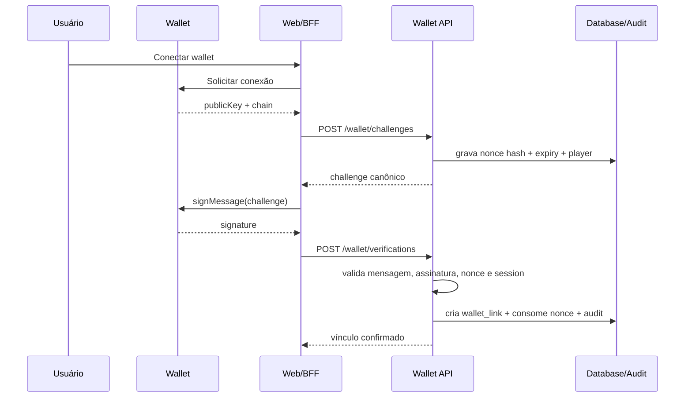

# MutterGames Web — Especificação de Conexão de Wallet

**Versão:** 1.0  
**Rede inicial:** Solana devnet  
**Objetivo:** vincular uma carteira ao Mutter ID por prova de controle, sem movimentar fundos

## 1. Modelo de identidade

`player_id` é identidade interna. Wallet address é credencial pública vinculada. Um jogador pode possuir várias wallets; um endereço ativo só pode pertencer a um jogador, salvo workflow de disputa/migração. O vínculo não concede custódia nem autoridade de transferência.

## 2. Wallets suportadas

Usar Wallet Standard para descoberta/conexão. Começar com carteiras compatíveis testadas, sem hardcode exclusivo. Mobile deve suportar fluxo compatível/deep link apenas após teste de segurança. Embedded wallet é fase posterior e usa o mesmo modelo de vínculo.

## 3. Fluxo



## 4. Challenge canônico

Formato inspirado em “sign-in” domain-separated, mas tratado como protocolo MutterGames versionado:

```text
MutterGames Wallet Link
Version: 1
Domain: account.mutter.games
URI: https://account.mutter.games/account/wallets
Chain: solana:devnet
Address: <base58-public-key>
Player: <opaque-session-subject>
Nonce: <128-bit-random-base64url>
Issued At: 2026-08-04T15:04:05Z
Expiration Time: 2026-08-04T15:09:05Z
Request ID: <uuid>
Statement: Vincule esta carteira à sua conta. Esta assinatura não movimenta fundos.
```

Mensagem usa UTF-8 exato, LF e canonicalização fixa. Nunca pedir assinatura de texto vazio ou ambíguo.

## 5. Endpoints

### POST `/v1/wallet/challenges`

Request autenticado:

```json
{"chain":"solana:devnet","address":"base58","purpose":"link"}
```

Response:

```json
{"challenge_id":"uuid","message":"...","expires_at":"...","algorithm":"ed25519"}
```

### POST `/v1/wallet/verifications`

```json
{
  "challenge_id":"uuid",
  "address":"base58",
  "signature":"base64url",
  "wallet_name":"display-only"
}
```

Resposta retorna `wallet_link_id`, address, chain, verified_at e status. Nunca retorna nonce reutilizável.

### DELETE `/v1/wallet-links/{id}`

Exige sessão recente/step-up. Revoga vínculo; não movimenta ativos. Operações pendentes entram em review conforme policy.

## 6. Validação server-side

1. Sessão autenticada e não revogada.
2. Challenge existe, purpose correto, não consumido e não expirado.
3. Domain/URI/chain correspondem ao ambiente.
4. Address válido e igual ao challenge.
5. Assinatura Ed25519 válida sobre bytes exatos.
6. Nonce gerado criptograficamente e single-use.
7. Address não vinculado a outro jogador ativo.
8. Rate limit e risk policy aprovados.
9. Challenge consumido e vínculo criados atomicamente.
10. Audit log sem armazenar dados secretos.

## 7. Ameaças e controles

| Ameaça | Controle |
|---|---|
| Replay | nonce single-use, expiry e atomic consume |
| Phishing de domínio | domain/URI na mensagem e comunicação clara |
| Wallet errada | address/chain exibidos e verificados |
| Session fixation | challenge ligado ao subject/session e step-up |
| CSRF | same-site cookie, origin check e CSRF token |
| Signature substitution | canonical bytes e address derivado/validado |
| Address squatting | unique constraint + dispute workflow |
| XSS/extension abuse | CSP, dependency review e zero secrets |
| Enumeration | respostas não revelam dono do endereço |
| Brute force/abuso | rate limit, risk score e cooldown |

## 8. Estados de UI

`DISCONNECTED`, `CONNECTING`, `CONNECTED_UNVERIFIED`, `CHALLENGE_READY`, `AWAITING_SIGNATURE`, `VERIFYING`, `LINKED`, `REJECTED`, `EXPIRED`, `NETWORK_MISMATCH`, `ADDRESS_CONFLICT`, `RATE_LIMITED`. Cada estado possui CTA e mensagem não técnica.

## 9. Mensagens essenciais

- Antes: “Você assinará uma mensagem gratuita; nenhum ativo será transferido.”
- Rejeição: “A assinatura foi cancelada. Sua carteira continua segura e desconectada.”
- Expiração: “O pedido expirou. Gere uma nova solicitação.”
- Rede errada: “Selecione Solana Devnet para este ambiente de testes.”
- Conflito: “Esta carteira já está vinculada. Procure o suporte; não compartilhe sua seed.”

## 10. Consulta de saldos e NFTs

Após vínculo, backend/indexer consulta dados públicos. Browser não precisa expor RPC key. UI mostra freshness e cluster. Dados on-chain não são prova de entitlement até passar collection allowlist, metadata validation e compatibility mapping.

## 11. Privacidade

Address é dado pseudônimo e pode ser correlacionável. Armazenar somente o necessário; ocultar parcialmente em UI/logs; analytics recebe um ID agregado, não address. Explicar que blockchain pública não pode ser apagada.

## 12. Testes de aceite

- Wallet suportada vincula com uma assinatura.
- Signature rejeitada não cria vínculo.
- Replay falha.
- Challenge expirado falha.
- Address ou chain alterados falham.
- Sessão diferente/expirada falha.
- Dois requests concorrentes criam no máximo um vínculo.
- Revogação exige step-up e registra audit.
- Fluxo funciona sem wallet instalada, com instrução segura.
- Nenhum teste solicita seed ou transação financeira.

## 13. Evolução

Fase 2: mobile/deep links, múltiplas carteiras e recuperação aprimorada. Fase 3: embedded wallet/passkey/MPC com adapter. Fase 4: session keys limitadas. Assinatura de transação/checkout é especificação separada e nunca reutiliza challenge de vínculo.

